Project and Menus
=================

Everything you make in MASAFI-SimTwin lives in a **project**: one file that
holds all the models of a piece of work. This page shows you the window, how to
make, open and close a project, how to add models to it, how your work is saved,
and what each menu holds.

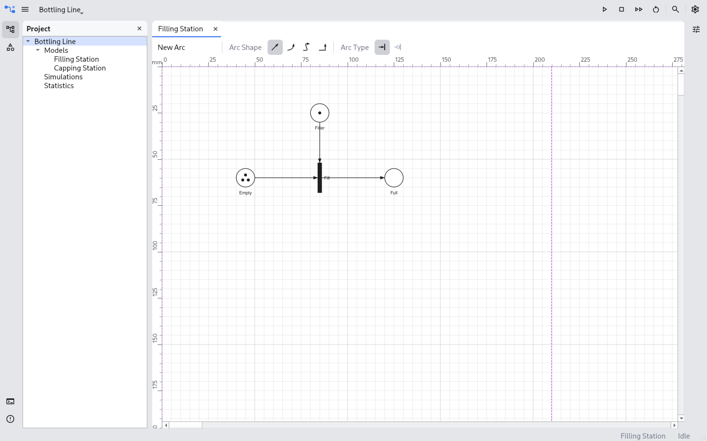

   The window with the *Bottling Line* project open and its *Filling Station*
   model in a tab.

The window
----------

The window has four parts:

The top bar
   From left to right: the main menu button (:guilabel:`☰`), the name of the
   open project, which opens a list of recent projects, and, on the right, the
   simulation controls, search and settings.

The tool stripes
   The narrow columns of buttons on the left and right edges. Each button opens
   a **pane**: :guilabel:`Project` and :guilabel:`Libraries` at the top of the
   left stripe, :guilabel:`Python Console` and :guilabel:`Problems` at the
   bottom, and :guilabel:`Properties` on the right.

The document area
   The middle of the window. Every model you open is a tab here.

The status bar
   The line along the bottom. It says what has just happened, such as a
   project opened or saved, and it names the model you are looking at.

The simulation controls (run, stop, fast forward and reset) and search are
there to show where they will be; they do nothing yet.

The panes
~~~~~~~~~

Click a stripe button to open its pane, and click it again to close it. Only
one pane of each group is open at a time: opening :guilabel:`Libraries` closes
:guilabel:`Project`, and the panes at the bottom take the whole width of the
window.

:guilabel:`Project`
   What the open project holds. It opens by itself when you open a project.

:guilabel:`Libraries`
   The elements a model is drawn with, grouped by kind of model. Drag one onto
   a model to add it.

:guilabel:`Properties`
   The name, the tokens, the description and the appearance of what is selected
   in the model you are looking at, ready to be changed. With nothing selected
   it shows the model itself.

:guilabel:`Python Console` and :guilabel:`Problems`
   Not built yet.

The main menu
~~~~~~~~~~~~~

The menu bar is folded into the :guilabel:`☰` button to leave more room for
the model. Click the button and the menus take its place; they fold away again
when you choose an entry or click anywhere else.

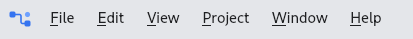

   The menus, unfolded.

While no project is open only :guilabel:`File` and :guilabel:`Help` are there:
the other menus act on a project and appear when you open one.

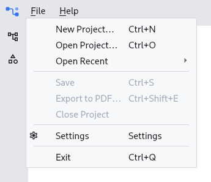

   With no project open, the window offers to make one or open one.

Projects
--------

A project is **one file**, ending in ``.mfstz``. Everything in it travels
together: you can copy it, send it or keep it under version control as one
thing.

A project knows its own name, which is written inside the file. Renaming the
file in your file manager does not rename the project: it still opens under
the name it was given.

Making a project
~~~~~~~~~~~~~~~~

Choose :menuselection:`File --> New Project…` (:kbd:`Ctrl+N`).

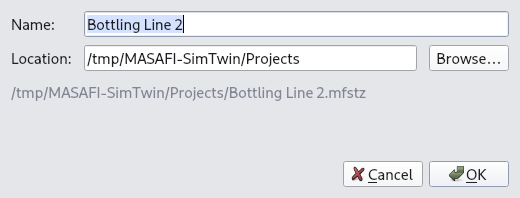

   The New Project dialog. The file it will make is shown under the fields.

:guilabel:`Name`
   What the project is called. The file is named after it.

:guilabel:`Location`
   The folder the file goes in. :guilabel:`Browse…` lets you pick one.

The full path of the file is shown under the two fields. :guilabel:`OK` stays
disabled until there is a name, the folder exists and no file of that name is
already there. The new project opens straight away.

Opening a project
~~~~~~~~~~~~~~~~~

There are three ways:

- :menuselection:`File --> Open Project…` (:kbd:`Ctrl+O`) asks for a
  ``.mfstz`` file.
- :menuselection:`File --> Open Recent` lists the projects you opened last,
  newest first.
- The project name on the top bar opens the same list, with
  :guilabel:`Open Project…` at its head.

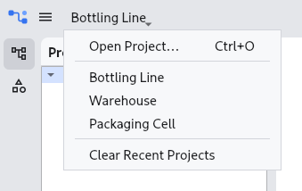

   The recent projects, under the project name on the top bar.

Recent projects are listed by name. Two projects with the same name show their
path as well, so you can tell them apart, and a project whose file is no longer
there is dropped from the list. :guilabel:`Clear Recent Projects` empties the
list; the projects themselves are not touched.

Opening a project closes the one that was open, saving it first.

**A project can be open in one window only.** If it is already open, in another
window or by somebody else on a shared folder, you are told who has it and it
is not opened a second time: two windows writing to one file would lose each
other's work.

The Project pane
~~~~~~~~~~~~~~~~

The :guilabel:`Project` pane shows the project as a tree: its name, then
:guilabel:`Models`, :guilabel:`Simulations` and :guilabel:`Statistics`.
Simulations and statistics will be filled in once models can be run.

Right-click a node to see what can be done to it.

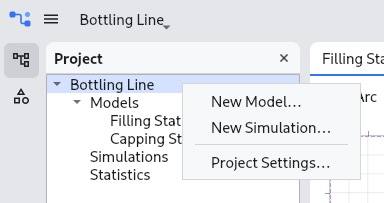

   The project's context menu: the same entries as the Project menu.

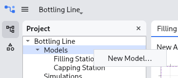

   :guilabel:`Models` offers to add a model.

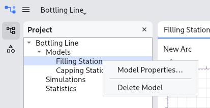

   A model can be changed or deleted.

Closing a project
~~~~~~~~~~~~~~~~~

:menuselection:`File --> Close Project` saves the project and closes it, with
all its tabs. Opening another project and quitting do the same.

Models
------

A project holds any number of models. Each one is drawn in a tab of its own.

Adding a model
~~~~~~~~~~~~~~

Choose :menuselection:`Project --> New Model…`, or right-click the project or
:guilabel:`Models` in the :guilabel:`Project` pane.

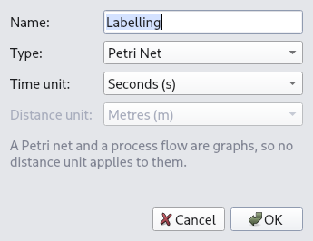

   The New Model dialog.

:guilabel:`Name`
   What the model is called. Two models of one project cannot share a name.

:guilabel:`Type`
   What kind of model it is. Only :guilabel:`Petri Net` can be made today; the
   other kinds are listed to show what is coming, and choosing one tells you it
   is not built yet.

:guilabel:`Time unit`
   The unit the model's times are written in.

:guilabel:`Distance unit`
   The unit its distances are written in. Only 2D and 3D models have
   distances, so it is disabled for a Petri net and for a process flow.

The new model opens in a tab, ready to be drawn.

Opening, changing and deleting a model
~~~~~~~~~~~~~~~~~~~~~~~~~~~~~~~~~~~~~~

Double-click a model in the :guilabel:`Project` pane to open it. A model is
open in one tab at most: double-clicking a model that is already open brings
its tab to the front.

Right-click a model and choose :guilabel:`Model Properties…` to rename it or
change its units. Its type was settled when it was made and cannot be changed.

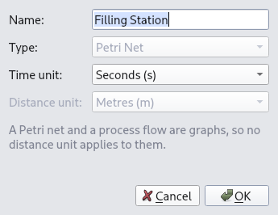

   A model's properties: the type is shown but cannot be changed.

:guilabel:`Delete Model` removes the model and everything drawn in it. It asks
first, because **a deleted model cannot be got back**: undo does not reach it.

Saving your work
----------------

:menuselection:`File --> Save` (:kbd:`Ctrl+S`) saves every open model.
MASAFI-SimTwin also saves on its own:

- when you close a model's tab, close the project, open another or quit;
- every few minutes while you work. You choose how often in
  :menuselection:`Settings --> Saving`, from 1 to 30 minutes; the default is
  5, and 0 turns it off.

A model with changes that are not saved yet has an asterisk after its name on
its tab, and the window's title says so too. Undoing back to what was saved
takes the asterisk away.

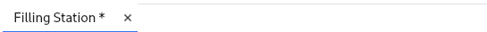

   The asterisk: this model has changes that are not saved yet.

A model that cannot be saved is named in a message, and the other models are
saved all the same. Today that is a Petri net with an inhibitor arc in it: the
file format cannot hold one yet. When such a model would be closed, you are
asked whether to close it without saving (:guilabel:`Discard`) or keep it open
(:guilabel:`Cancel`).

If the application stops
~~~~~~~~~~~~~~~~~~~~~~~~

Every change you make is written down beside the project the moment you make
it. If MASAFI-SimTwin stops before your work is saved, whether it crashed or
the computer went off, open the project again: the work is put back in its
tabs and the status bar names the models it was put back in.

What is put back is **shown, not saved**: the tabs carry the asterisk, so you
can look at it before you keep it. Save to keep it.

Earlier versions
~~~~~~~~~~~~~~~~

Every save that changes the project first keeps the project as it was, as a
numbered copy in a folder beside it: for *Bottling Line.mfstz*, the folder is
*Bottling Line.mfstz.versions*. The highest number is the newest, and it is
the project as it was just before the last save.

Once a project has kept more than 50 versions, opening it asks whether to
delete the oldest and keep the last 10. If you say no, nothing is deleted and
you are asked again next time.

A version is a whole project file. To go back to one, copy it out of the
folder, give it a name of its own and open the copy. Do not open it inside the
folder.

The files beside a project
~~~~~~~~~~~~~~~~~~~~~~~~~~

Next to *Bottling Line.mfstz* you may see:

``Bottling Line.mfstz.lock``
   Says the project is open, and by whom. It goes when the project is closed;
   one left by a crash is cleared the next time the project is opened on the
   same computer.

``Bottling Line.mfstz.journal``
   The changes not saved yet: what is put back after a crash.

``Bottling Line.mfstz.versions``
   The earlier versions.

Leave them alone while the project is open. To move or rename a project, close
it first and move the ``.versions`` folder along with it: the application
cannot see a file being renamed, so the versions of a renamed project stay
behind under the old name.

The menus
---------

Entries that are not built yet are shown greyed out, so you can see where they
will be.

.. list-table::
   :header-rows: 1
   :widths: 15 85

   * - Menu
     - What it holds
   * - :guilabel:`File`
     - :guilabel:`New Project…`, :guilabel:`Open Project…`,
       :guilabel:`Open Recent`, :guilabel:`Save`, :guilabel:`Export to PDF…`,
       :guilabel:`Close Project`, :guilabel:`Settings` and :guilabel:`Exit`.
   * - :guilabel:`Edit`
     - :guilabel:`Undo` and :guilabel:`Redo`, then :guilabel:`Cut`,
       :guilabel:`Copy` and :guilabel:`Paste`. They act on the model you are
       looking at.
   * - :guilabel:`View`
     - Tool windows, appearance and zoom: not built yet.
   * - :guilabel:`Project`
     - :guilabel:`New Model…`, :guilabel:`New Simulation…` and
       :guilabel:`Project Settings…`. Only the first is built.
   * - :guilabel:`Window`
     - Moving between tabs: not built yet.
   * - :guilabel:`Help`
     - :guilabel:`About MASAFI-SimTwin`, with the version you are running.
       :guilabel:`Documentation` is not built yet.

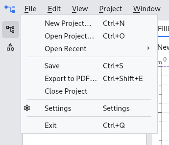

   :guilabel:`File`.

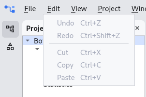

   :guilabel:`Edit`.

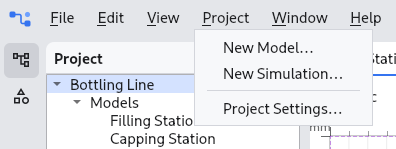

   :guilabel:`Project`.

:guilabel:`Settings` is also the gear button at the right end of the top bar.
Exporting a model to PDF and the editing commands are described in
:doc:`petri_nets`.

Keyboard shortcuts
~~~~~~~~~~~~~~~~~~

.. list-table::
   :header-rows: 1
   :widths: 30 70

   * - Keys
     - What they do
   * - :kbd:`Ctrl+N`
     - New project
   * - :kbd:`Ctrl+O`
     - Open a project
   * - :kbd:`Ctrl+S`
     - Save
   * - :kbd:`Ctrl+Shift+E`
     - Export the model to PDF
   * - :kbd:`Ctrl+Z`
     - Undo
   * - :kbd:`Ctrl+Shift+Z`
     - Redo
   * - :kbd:`Ctrl+X`, :kbd:`Ctrl+C`, :kbd:`Ctrl+V`
     - Cut, copy and paste
   * - :kbd:`Ctrl+Q`
     - Exit

On a Mac, :kbd:`⌘` takes the place of :kbd:`Ctrl`. Windows has no shortcut
for :guilabel:`Exit`: close the window with :kbd:`Alt+F4`.
